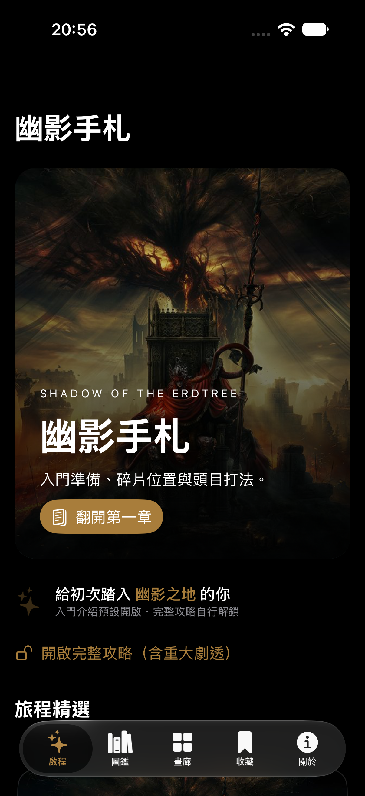
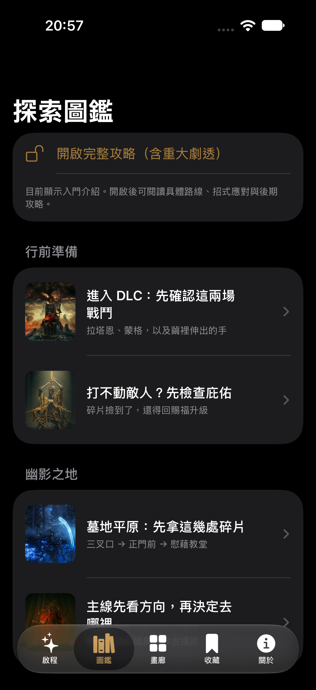
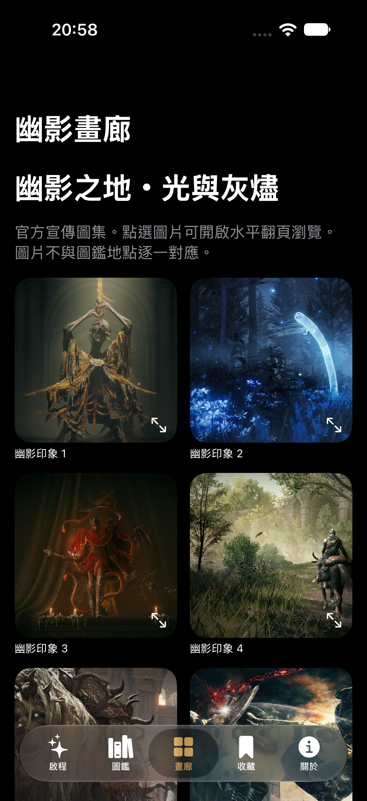
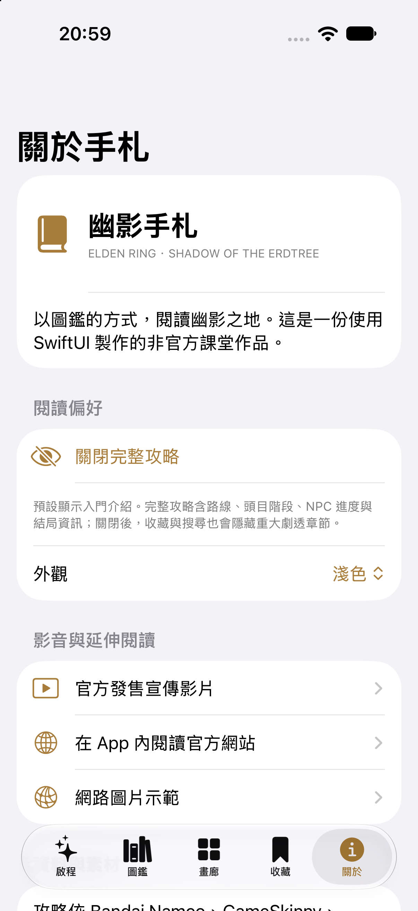

# 幽影手札｜Elden Ring Shadow Guide

《艾爾登法環：黃金樹幽影》介紹與攻略電子書，SwiftUI 課堂作業。

## 執行專案

1. 使用 Xcode 27 開啟 `PocketLibrary.xcodeproj`。
2. Scheme 選 `PocketLibrary`，選擇 iOS／iPadOS 18 以上模擬器。
3. 按 `Command + R`。無第三方套件，模擬器無須設定開發者 Team。

## 功能

- 10 篇章節、29 段攻略：進入條件、碎片位置、武器取得、頭目應對與支線提醒。
- 完整攻略預設鎖定，確認劇透範圍後開啟；關閉時同步隱藏重大劇透章節。
- 分類圖鑑、搜尋、收藏、字級與外觀設定。
- 圖片牆、水平分頁、動畫與減少動態效果支援。
- VideoPlayer、WKWebView 與 AsyncImage。
- iPhone 下方 tab bar，iPad 上方分頁列及可展開的側邊欄。

## Demo 與作業說明

- [iPhone demo（約 76 秒，無旁白）](docs/media/iPhone-demo精簡版.mp4)
- [iPad demo（約 25 秒）](docs/media/iPad-demo.mp4)
- [Medium 文章與實際截圖](docs/Medium文章.md)
- [作業功能對照](作業對照與Xcode操作.md)
- [驗證紀錄與已知限制](驗證紀錄.md)

## 截圖

| 圖鑑 | 圖片牆 | 淺色模式 |
|---|---|---|
|  |  |  |

## 引用與素材

攻略依公開來源摘要改寫，每篇 App 章節提供原文連結。完整對照見 [攻略引用與編寫範圍](攻略引用與編寫範圍.md)，宣傳圖來源見 [SOURCES.md](SOURCES.md)。本作品使用 AI 協助程式、資料整理與文章草稿，不宣稱所有遊戲戰術均經逐招實測。

遊戲宣傳圖 ©Bandai Namco Entertainment Inc. / ©FromSoftware, Inc.；攻略原文權利屬原作者與網站。本專案為非官方課堂習作，與遊戲官方無隸屬關係，未對第三方素材另行授權。
