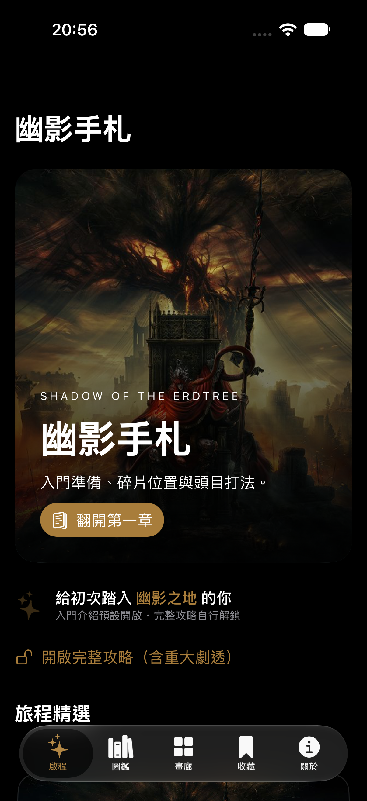
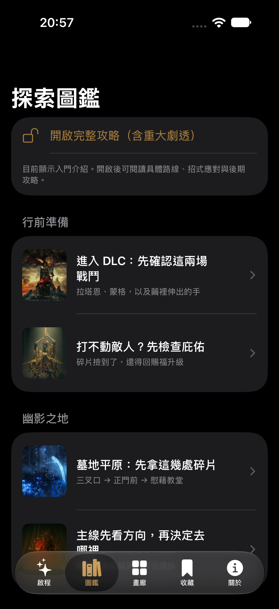
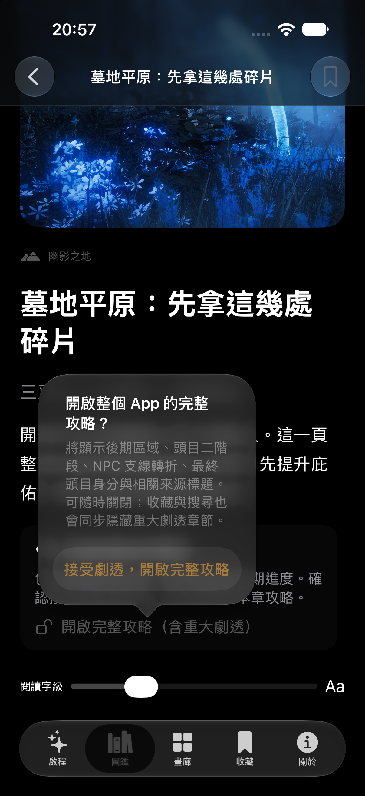
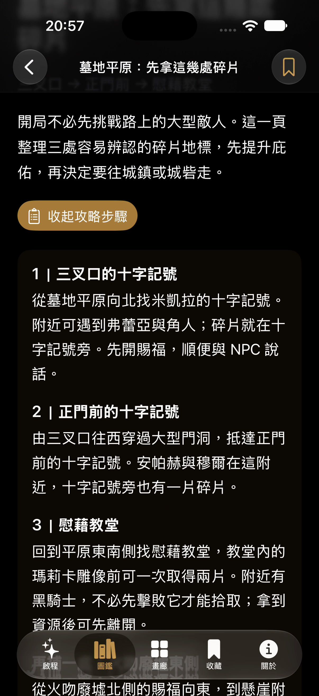
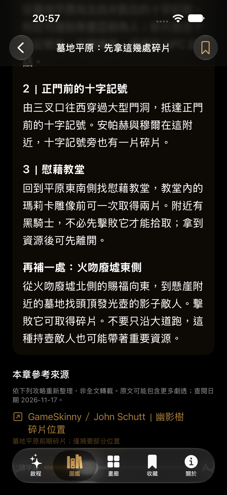
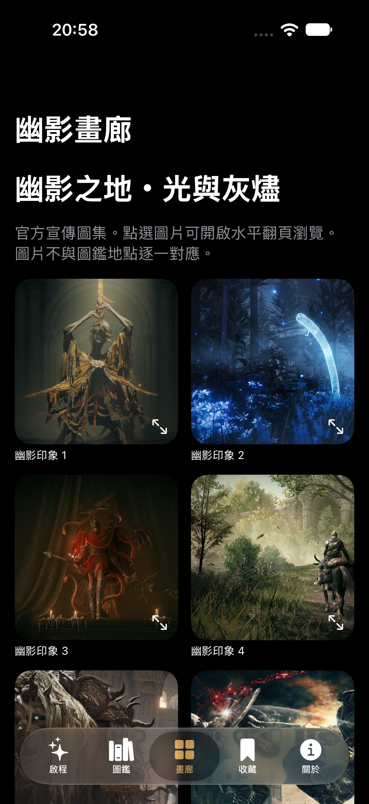
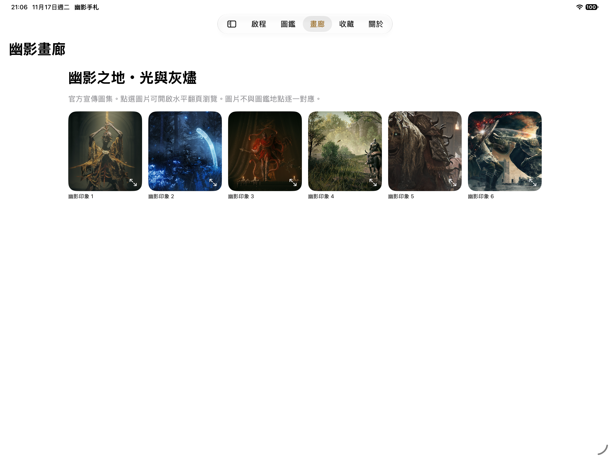
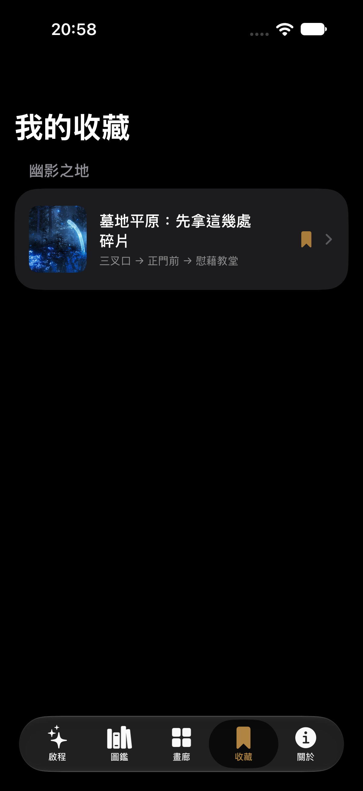
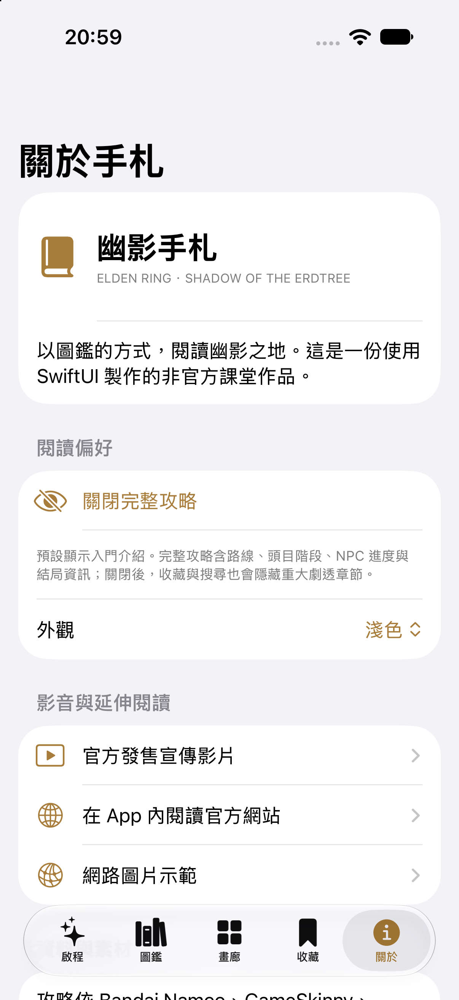

# #88 SwiftUI 電子書 App｜幽影手札：艾爾登法環 DLC 介紹與攻略

這次作業以《艾爾登法環：黃金樹幽影》為主題，做了一本能查路線、看頭目打法的電子書 App，名稱是「幽影手札」。

第一版比較像遊戲介紹：有封面、圖片與幾段探索提醒，但看完仍然不知道要往哪裡走。後來把文字改成具體問題，例如「打完蒙格為什麼還進不去？」「開局去哪裡拿碎片？」「蕾菈娜的月亮到底要閃幾次？」。現在共有 10 篇章節、29 段攻略，分為行前準備、幽影之地、戰鬥筆記與故事線索。



*iPhone 首頁：以官方主視覺、金色文字與閱讀入口作為封面。*
## 操作影片

【在這裡貼上 iPhone demo 的 YouTube 或其他 Medium 支援影片網址】

已錄製 iPhone 精簡版約 76 秒、完整版約 3 分 12 秒，以及 iPad 約 25 秒的操作影片。精簡版展示首頁、圖鑑、攻略解鎖、收藏、畫廊與淺色模式；iPad 片段補上側邊欄與上方分頁列。這些影片目前只保存在本機，尚未上傳。

## 用分頁把內容分開

主要畫面分成啟程、圖鑑、畫廊、收藏與關於。每個分頁各有一個 `NavigationStack`，再以 `NavigationLink(value:)` 傳入要閱讀的章節。

```swift
TabView {
    Tab("啟程", systemImage: "sparkles") {
        NavigationStack { HomeView() }
    }
    Tab("圖鑑", systemImage: "books.vertical") {
        NavigationStack { CatalogView() }
    }
    // 畫廊、收藏與關於省略
}
.tabViewStyle(.sidebarAdaptable)
```

iPhone 的 tab bar 在下方；iPad 可以顯示上方分頁列，也能展開側邊欄。這次分別在 iPhone 18 Pro 與 iPad Pro 13 吋模擬器執行並截圖。



*圖鑑使用 List 與 Section，依內容分類列出章節。*


*iPad 橫向：展開側邊欄後，章節入口集中在左側。*
## 攻略先收起，願意看再解鎖

介紹 DLC 很容易遇到劇透問題。只想找入口的人，不一定想先知道最終頭目是誰。因此預設顯示入門介紹，詳細攻略由使用者自行開啟。

按下「開啟完整攻略」會先說明劇透範圍，包括後期區域、頭目二階段、NPC 轉折與最終頭目身分。接受後，閱讀頁直接展開本章步驟；關閉後，重大劇透章節會從圖鑑、搜尋與收藏隱藏，已開啟的頁面也會遮蔽內容。



*解鎖前先說明範圍；這個開關會套用到整個 App。*
資料使用遵從 `Identifiable` 與 `Hashable` 的 `Entry`，所有章節放在 `[Entry]` 陣列裡。攻略段落另用 `GuideSection` 保存標題與文字，來源用 `sourceIDs` 對應。

```swift
struct GuideSection: Identifiable, Hashable {
    let title: String
    let text: String
    var id: String { title }
}
```

比起把整篇攻略塞成一塊文字，分段後能直接找到「取得位置」「招式應對」或「進度提醒」。例如墓地平原章節就依三叉口、正門前、慰藉教堂與火吻廢墟東側分開整理。



*實際攻略閱讀畫面；本圖由操作錄影擷取。*
## 每篇保留攻略來源

內文依網路攻略摘要改寫，沒有把整篇文章直接搬進 App。閱讀頁會列出本章參考的文章與使用範圍，「關於」則整理全部來源。部分文章標題本身可能暴雷，因此相關連結也跟隨劇透開關顯示。

舊攻略也不能照單全收。例如 GameSpot 的最終頭目攻略寫於 2024 年 6 月，官方後來在 1.14 調整了開場與部分攻擊。本作品沒有沿用「開場一定出某招」的說法，並另外附上更新公告。引用 1.14 是交代舊資料的差異，不代表目前版本就是 1.14。



*每章下方提供對應來源，讓讀者能繼續查原文。*
## 圖片牆與水平瀏覽

畫廊使用 `LazyVGrid` 的自適應欄寬；iPhone 顯示兩欄，較寬的 iPad 可顯示更多圖片。點圖後以 sheet 開啟全幅瀏覽，內部使用 `.tabViewStyle(.page)`。

首頁同時放了精選分頁與水平 `ScrollView`，外層則是可上下捲動的 `ScrollView`。分類標題使用 `LazyVStack(pinnedViews: [.sectionHeaders])`。



*iPhone 的兩欄圖片牆，圖像使用圓角裁切與 saturation 調整。*


*同一個畫廊在 iPad 顯示更多欄位；上方為原生分頁列。*
圖片與卡片排版曾出現直式畫面被撐寬的問題。後來改成由外層決定寬高，再把圖片放在 overlay 裡裁切，避免原始圖片比例參與父層寬度計算。共用卡片圓角與描邊則集中在 `ShadowCardStyle: ViewModifier`。

圖片均為遊戲官方宣傳素材，只用於氣氛展示，並不是每篇地點或頭目的精確對照圖。

## 動畫、收藏與閱讀設定

首頁星光圖示使用 `symbolEffect(.pulse)`，另以 `animation` 控制緩慢旋轉。攻略區塊的展開與收起使用 `withAnimation` 搭配 `transition`。系統開啟減少動態效果時，會停用持續動畫與區塊轉場。

收藏由 `ReadingStore` 管理，章節 ID 寫入 `UserDefaults`；字級、外觀與劇透偏好使用 `@AppStorage`。這次操作錄影確認了加入書籤後，章節會出現在收藏清單。



*把碎片攻略加入書籤後，可從收藏頁重新開啟。*
淺色與深色介面使用系統語意色調整閱讀區與文字，封面仍保持黑金色風格。



*從「關於」切換到淺色模式，閱讀與列表背景會同步更新。*
## VideoPlayer、WebView 與 AsyncImage

「關於」提供官方影片、內嵌官方網站與網路圖片頁。影片使用 `VideoPlayer` 搭配 `AVPlayer` 播放官方商店的 HLS 串流；內嵌網頁以 `UIViewRepresentable` 包裝 `WKWebView`；圖片示範使用 `AsyncImage` 處理載入中、成功與失敗狀態。

本次錄影看到影片首幀與播放秒數前進，但沒有驗證完整影片。官方網站在這次等待期間仍未顯示內容，因此沒有把空白頁當成網頁功能成功的展示。主要攻略與圖片放在 App 裡，這些內容不依賴網路。

## 名稱、圖示與啟動畫面

App 顯示名稱為「幽影手札」，App Icon 以書本、樹枝與金色圓環構成，放入 Asset Catalog。啟動畫面以 `Info.plist` 的 `UILaunchScreen` 指定背景色。

專案使用原生 SwiftUI，最低支援 iOS／iPadOS 18，沒有第三方套件。iOS 裝置與模擬器命令列編譯均通過；本次另在模擬器實際操作並錄影。尚未驗證的項目沒有用編譯成功代替，例如部分拖曳手勢與完整網路內容載入仍需再檢查。

## 這次實作的調整

這次最大的修改其實是內容，而不是多加一個按鈕。第一版只展示「可以做什麼」，改版後才開始回答玩家打開攻略時的問題。劇透開關也必須同時顧到列表、搜尋、收藏與引用標題，不能只遮住閱讀頁的一段文字。

本作業使用 AI 協助建立專案、整理程式、查找資料與撰寫文章草稿。攻略為來源摘要與重新編排，沒有宣稱是逐招遊戲實測；操作影片與截圖則來自實際執行的 App。

## 攻略與素材引用

查閱日期：2026-11-17。以下列出文章與實際使用範圍；原文與遊戲圖片的權利仍屬各作者及權利人。

- [Bandai Namco｜進入 DLC 與庇佑系統](https://en.bandainamcoent.eu/elden-ring/news/elden-ring-how-enter-the-realm-of-shadow)：進入條件、區域往返、庇佑用途。
- [GameSkinny／John Schutt｜幽影樹碎片位置](https://www.gameskinny.com/tips/where-to-find-all-50-scadutree-fragments-in-elden-ring-shadow-of-the-erdtree/)：墓地平原前期碎片；僅摘要部分位置。
- [PowerPyx｜DLC Walkthrough](https://www.powerpyx.com/elden-ring-shadow-of-the-erdtree-dlc-walkthrough/)：主線順序與燃燒封印樹前的支線警告。
- [Gamepressure｜DLC 新武器位置](https://www.gamepressure.com/elden-ring/all-weapons-in-dlc/zf11481)：仕女劍與大刀的位置。
- [GamesRadar+／Joel Franey｜雙月騎士攻略](https://www.gamesradar.com/games/action/elden-ring-shadow-of-the-erdtree-rellana-twin-moon-knight/)：魔力／火焰防禦、雙月衝擊波與攻擊時機。
- [EIP Gaming｜梅瑟莫頭目攻略](https://eip.gg/elden-ring/guides/messmer-the-impaler-boss/)：火球落地爆炸、蛇形攻擊與第二階段應對。
- [GameSpot／Jason Rodriguez｜DLC 最終頭目攻略](https://www.gamespot.com/articles/shadow-of-the-erdtree-final-boss-elden-ring-guide/1100-6524348/)：最終戰準備、聖屬性追擊與擁抱機制。
- [Bandai Namco｜1.14 更新公告](https://en.bandainamcoent.eu/elden-ring/news/elden-ring-patch-notes-version-114)：核對最終頭目已調整的開場、傷害與特效；不是宣稱目前最新版。

官方宣傳圖：[Bandai Namco《黃金樹幽影》官方頁面](https://en.bandainamcoent.eu/elden-ring/elden-ring/shadow-of-the-erdtree)

官方影片：[Steam 商店頁面](https://store.steampowered.com/app/2778580/)

©Bandai Namco Entertainment Inc. / ©FromSoftware, Inc. 本 App 為非官方課堂習作，與遊戲官方無隸屬關係。

作業題目：[彼得潘 #88 SwiftUI 電子書 App](https://medium.com/p/3ae9c256c960)

GitHub：https://github.com/94SungLA/EldenRing-ShadowGuide

署名／學號：【請填入】
